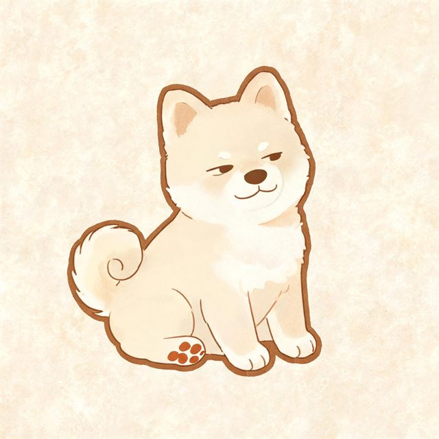

# 测测你是哪种小狗 · 狗系人格测试（Dog Personality Test）

> 24 道生活场景题，1 分钟测出你的**狗狗人格**：10 种狗型（含 2 只隐藏款）、八维性格雷达、逐条解读、双人合拍指数、可保存的结果海报。
> 纯前端静态网页，打开就能测，不用登录、不上传答案。

**在线体验**：https://37jccyzrulq8grzrqz6.traesite.cn

关键词：狗系人格测试 / 狗狗人格测试 / 测测你是哪种小狗 / 你是哪种狗 / 性格测试 / 人格测试 / 心理测试 / 宠物人格 / 双人合拍 / 情侣测试 / dog personality test / dog type quiz / personality quiz





---

## 这是什么

一个可以在手机和电脑上直接打开的性格测试小网页。回答 24 个日常场景题（周末怎么过、被否定时怎么办、朋友深夜找你……），系统会用 8 个维度给你的行为倾向打分，再从 10 种狗里找出最接近你的那一种。

它不是心理诊断，也不打算给你贴标签。它更像一面镜子：如果你看完觉得“被说中了”，那就笑一下；觉得不像，再测一次就好。

## 功能

- **24 道场景题**，约 1 分钟完成，无需注册登录
- **10 种狗系人格**：8 种常规 + 2 只隐藏款（需要特定维度组合才会出现）
- **八维性格雷达**：热情、黏人、好奇、秩序、坚韧、敏感、主见、松弛
- **逐条解读**：最突出的 2 个维度 + 相对最低的 1 个维度，解释“为什么是这只狗”
- **6 条日常表现 + 3 条“别人容易误会你”**，每只狗都有完整文案
- **双人合拍**：选两只狗，得到合拍指数、共同点、最大差异和相处建议，可生成分享链接
- **结果海报**：一键生成 750×1200 图片，手机长按 / 电脑右键即可保存
- **本地图鉴**：测出过的狗会点亮，隐藏款单独标记
- **分享深链**：结果和合拍都能通过链接直接打开，朋友不用重测

## 10 种狗型

| 编号 | 狗型 | 一句话 |
| --- | --- | --- |
| 01 | 金毛 | 温柔的气氛组 |
| 02 | 边牧 | 全能管事精 |
| 03 | 柴犬 | 独立节奏派 |
| 04 | 柯基 | 小个子大主意 |
| 05 | 萨摩耶 | 快乐制造机 |
| 06 | 拉布拉多 | 靠谱老实人 |
| 07 | 吉娃娃 | 外强中干的警报器 |
| 08 | 哈士奇 | 计划外的快乐 |
| H1 | 隐藏款 | 触发条件：低好奇 + 高坚韧 + 高松弛 |
| H2 | 隐藏款 | 触发条件：高坚韧 + 高主见 + 低热情 + 低黏人 |

## 八维模型

| 维度 | 含义 |
| --- | --- |
| 热情 | 对人和事的主动程度 |
| 黏人 | 需要陪伴与确认的程度 |
| 好奇 | 想尝试新东西的程度 |
| 秩序 | 对计划和条理的依赖 |
| 坚韧 | 扛事与坚持的程度 |
| 敏感 | 对情绪和细节的感知 |
| 主见 | 表达立场与做决定的程度 |
| 松弛 | 放下与不较劲的程度 |

## 计分是怎么算的

1. 每道题的 4 个选项，会分别给若干维度加 1～3 分。
2. 把每个维度的原始分除以“该维度在所有题里可能拿到的最高分”，得到 0～1 的比例。
3. 对 8 个比例做标准化（z-score），再映射到 5～95 的展示分。这样比较的是**你自身各维度的相对高低**，而不是和“标准人”比绝对值。
4. 把 10 种狗的性格画像也做同样的标准化，计算你的向量和每种狗的向量之间的均方距离，取最近的作为一种结果。
5. 隐藏款会先检查触发条件，条件满足且形状足够接近，才会顶掉常规结果。

所有计算都在浏览器里完成，不请求任何接口。

## 本地运行

不需要构建工具、不需要安装依赖，任意静态服务器即可：

```bash
# 任选一种
python -m http.server 8000
npx serve .
```

然后打开 <http://localhost:8000>。

直接双击 `index.html` 也能用，但建议用本地服务器，分享链接和图片加载会更稳。

## 目录结构

```
.
├── index.html          页面结构（首页 / 答题 / 结果 / 图鉴 / 合拍）
├── assets
│   ├── styles.css      设计令牌与全部样式
│   ├── data.js         8 个维度、10 种狗、24 道题、文案素材
│   ├── app.js          计分、匹配、雷达图、合拍、海报、分享
│   └── dogs             10 张狗型插画（640×640）
├── robots.txt
└── sitemap.xml
```

想改题目或加狗型，只需要动 `assets/data.js`：计分会自动按新的权重重新归一化，不用改逻辑。

## 常见问题

**这个测试准吗？**
它测的是日常行为倾向，不是心理诊断。8 个维度分别算相对高低，再和 10 种狗的性格画像比对，取最接近的一种。

**为什么每个人只有一种结果？**
因为取的是“最接近你”的那一种，而不是打分排名。在两种之间摇摆，说明这两只狗本身相似度很高。

**隐藏款怎么触发？**
需要特定的维度组合，图鉴里给出了触发方向的提示。能不能遇到有点看缘分。

**会收集我的答案吗？**
不会。没有后端、没有埋点、没有账号，图鉴只存在你自己的浏览器里。

## 适合谁

想做性格测试、想看“我是哪种狗”、想和朋友或对象测合拍、想给公众号或活动做一个互动小测试的人，都可以直接用。代码结构简单，也适合当作原生 JavaScript 小项目参考。

## 版权

页面里的文字与插画为本项目原创内容。**保留所有权利**：可以自由访问、分享链接、用于个人娱乐；未经授权请勿直接搬运文案与插画、二次售卖或做成付费产品。合作请联系仓库作者。

---

## English

A lightweight, dependency-free **dog personality test**. Answer 24 everyday-scenario questions and get one of 10 dog personality types (including 2 hidden ones), an 8-dimension personality radar, per-dimension explanations, a two-person compatibility score, and a downloadable result poster.

- Pure HTML / CSS / JavaScript, no build step, no backend, no tracking
- Mobile-first, works offline after loading
- Scoring: normalized z-scores across 8 traits, nearest-profile matching against 10 original dog profiles
- Keywords: dog personality test, dog type quiz, personality quiz, MBTI-like test, fun personality test, static website

**Live demo**: https://37jccyzrulq8grzrqz6.traesite.cn
